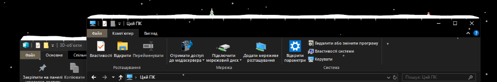
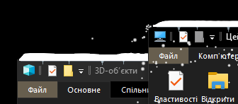

# ❄️ SnowApp — Festive Desktop Snow for Windows

A lightweight, fun winter overlay for Windows that brings falling snow, procedural snowdrifts, icicles, and festive holiday decorations directly onto your desktop, application windows, and taskbar!


---

## ✨ Features

- **🏔️ Real-time Snow Accumulation:** Falling snowflakes naturally settle onto the top borders of your active windows and the taskbar, forming smooth, fluffy snowdrifts.
- **🎄 Procedural Holiday Decorations:** Windows randomly sprout frosted pine trees topped with golden stars and cheerful little snowmen buried snugly in the snow.
- **🧊 Crystal Icicles & Frost Glaze:** Delicate icicles grow beneath snowbanks, complete with subtle ice glazing along window headers.
- **🌬️ Physical Snow Cascades:** Moving, resizing, or clicking **"Shake off snow"** triggers a real-time particle avalanche that cascades down with realistic air drag and gravity.
- **👁️ Smart Z-Order Occlusion:** Snowdrifts, trees, and icicles smoothly submerge behind overlapping foreground windows and completely vanish during fullscreen videos (YouTube, VLC) and gaming.
- **🪶 Hyper-Lightweight & Battery-Friendly:** Built on native Win32 `UpdateLayeredWindow` using raw pointer DIB sections. Zero heavy UI frameworks, consuming only **~17.5 MB RAM** and **< 1% CPU**.
- **🧼 Clean System Tray Integration:** Single-instance mutex prevents duplicate processes, with automatic ghost tray icon cleaning and easy controls.

---

## 📸 Screenshots

| Festive Window Decorations | Physical Shake Avalanche |
| :---: | :---: |
|  |  |

---

## 🚀 Quick Start

### Option 1: Download Pre-built Release (Recommended)
1. Head over to the **[Releases](https://github.com/directive32/snow-app/releases)** page.
2. Download `snow_app_v1.0.0.zip`.
3. Extract and double-click `snow_app.exe`. No installation required!

### Option 2: Build from Source
Ensure [.NET 6.0 SDK](https://dotnet.microsoft.com/download/dotnet/6.0) is installed:

```bash
git clone https://github.com/directive32/snow-app.git
cd snow-app
dotnet publish -c Release
```
The compiled executable will be available in `bin/Release/net6.0-windows/publish/snow_app.exe`.

---

## 🎛️ Controls & Tray Menu

Right-click the ❄️ snowflake icon in the system notification area:

* **Пауза (Pause):** Freeze falling flakes and animations.
* **Інтенсивність (Intensity):**
  * Light Snow (150 flakes)
  * Moderate Snow (300 flakes — default)
  * Blizzard (600 flakes)
* **Струсити весь сніг (Shake Off All Snow):** Causes all accumulated snowbanks to tumble down the screen in a falling avalanche, leaving windows clean.
* **Відновити замети на вікнах (Restore Snowbanks):** Instantly repopulates fresh snowdrifts, icicles, and festive trees across all windows.
* **Вихід (Exit):** Cleanly shuts down the overlay and removes the tray icon.

---

## 🛠️ Architecture

* **Engine:** Pure C# (.NET 6 Windows Forms host with Win32 interop).
* **Renderer:** Software rasterizer writing directly to a 32-bit ARGB DIB section using premultiplied alpha, presented via Windows Desktop Window Manager (`UpdateLayeredWindow`).
* **Obstacle Tracking:** Dedicated low-priority background thread polling window positions with Win32 Extended Frame Bounds (`DwmGetWindowAttribute`), maintaining an occluded Z-order stack.
* **Memory Management:** Zero per-frame heap allocations; periodic trim keeps working set strictly under 18 MB.

---

## 📄 License

This project is licensed under the [MIT License](LICENSE).
